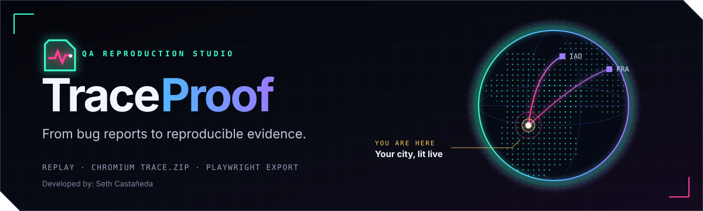
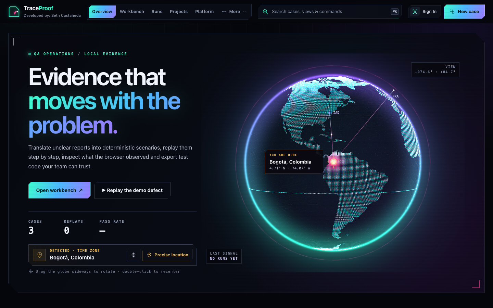
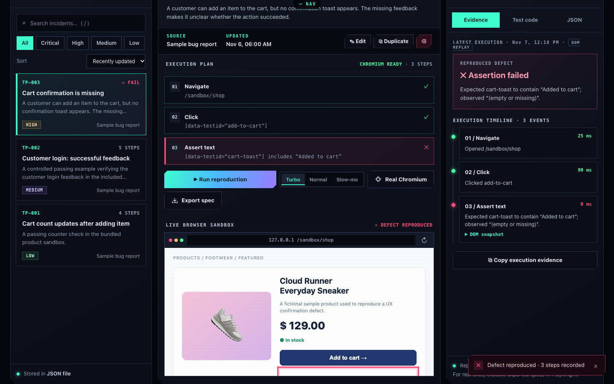
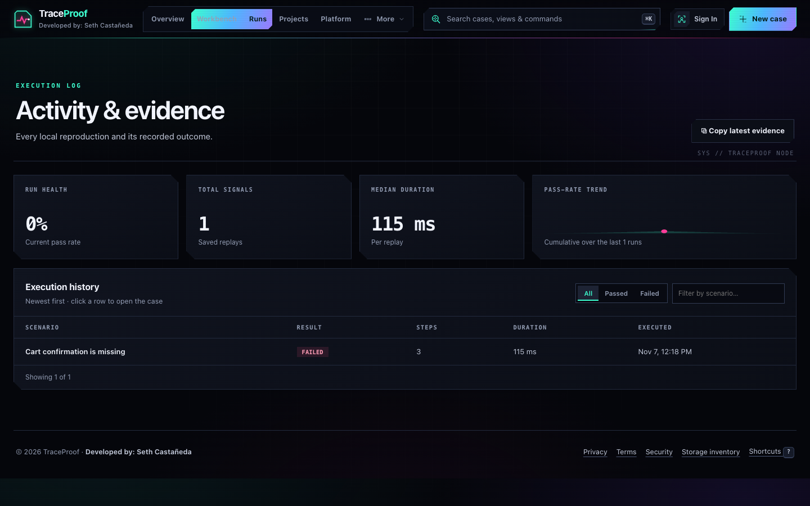
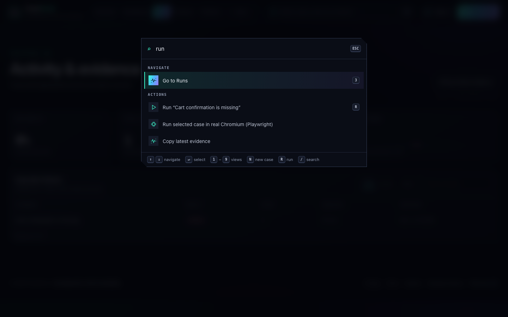
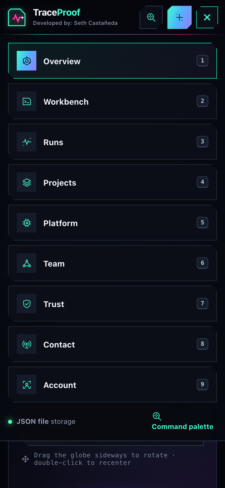
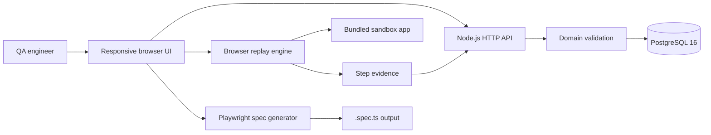

<div align="center">



# TraceProof
### QA Reproduction Studio · From bug reports to reproducible evidence

[](https://github.com/Name-less56/traceproof-qa/actions/workflows/ci.yml)

**A portfolio-ready QA operations workspace with PostgreSQL, Docker, role-aware sessions, controlled browser replay, evidence capture, and Playwright export.**

Developed by: **Seth Castañeda**

</div>



## Why TraceProof?

A defect report is useful only when another engineer can reproduce it. TraceProof keeps the steps, observed behavior, and test code together in one focused quality-engineering workspace.

## Quick start

**Recommended: Docker Desktop.**

```bash
docker compose up --build -d
# Open http://127.0.0.1:4391
```

Data survives restarts in a named PostgreSQL volume. `docker compose down` stops the stack without removing it. The lightweight fallback is `npm install && npm start`.

| Role | Email | Password |
|---|---|---|
| Administrator | `admin@traceproof.local` | `TraceProof!2026` |
| QA engineer | `qa@traceproof.local` | `Quality!2026` |

Run the built-in unit and HTTP API checks:

```bash
npm test
```

## Features that work

### Version 2.2 command interface

- **Real Playwright runner** — “Real Chromium” runs a case in an isolated headless Chromium on the server, records a genuine **`trace.zip`** and a final screenshot, and stores the run next to the DOM replays (requires a signed-in engineer/admin and `npm run playwright:install`).
- **Auto-hiding command bar** — collapses into a neon line with a scan spark when you scroll down and unfolds with a glitch reveal when you scroll up, hover the top edge or press the **NAV** tab. Cyberpunk SVG icon set and a full-width search.
- **Globe that reacts to evidence** — every finished run fires a green / red shockwave from your city along the hub arcs; the globe only rotates on horizontal drags so vertical gestures keep scrolling the page.
- **Top command bar** with a liquid tab indicator, a "More" drop-down for secondary views, a scroll-progress line and a top sheet menu on tablet/mobile.
- **Command palette** (`⌘K` / `Ctrl K`) to jump to any view, open any case, run, export or change replay speed. Shortcuts: `1`–`9` views, `N` new case, `R` run, `/` search.
- **WebGL planetary globe** (GPU point cloud, ~73k points) with atmosphere, graticule, scan sweep, drag-to-rotate with inertia, keyboard control and a Canvas 2D fallback. The visitor's city is lit up from the browser time zone (no network, no prompt); precise location is optional and consent-based.
- **Live replay**: speed control (Turbo / Normal / Slow-mo), progress bar and the element under test highlighted inside the sandbox (amber → green / red).
- **Runs view** with result filters, search, clickable rows, median duration and a cumulative pass-rate sparkline; Platform trend bars are computed from real runs.
- **Overview** with animated metrics, pass-rate ring, recent-signal feed and one-click quick replay.
- Rebuilt **Neon Ops** design system: single token layer, higher-contrast text, cyan / magenta / violet cyberpunk palette.

### Screenshots

| Workbench · replay + Chromium artifacts | Runs · filters + trend |
|---|---|
|  |  |
| **Command palette (⌘K)** | **Mobile top menu** |
|  |  |

Regenerate them from the live app with `npm run screenshots`.

### Version 2.1 platform

- Real-geography particle Earth with 73,000+ rendered land/ocean points, pointer parallax, city highlighting, and explicit geolocation consent.
- Control-plane adapters for multi-browser workers, trace.zip indexing, assisted test authoring, GitHub/Jira/Slack, SSO/MFA policy, signed audit state, nightly agents, local notifications, release trends, regional/browser matrices, API keys, and SDK examples.
- Credential-dependent services are visibly marked `simulated` until provider credentials are supplied; their local state transitions, audit records, trace inspection, test creation, key hashing, and PostgreSQL persistence are functional.

- **Case library:** create, edit, duplicate, search, filter, delete, import, and export test cases.
- **Visual replay:** execute structured interactions against **two included sandbox pages** in an embedded same-origin browser frame.
- **Reproducible defect:** one demo case intentionally fails when a shop updates its cart but omits user confirmation.
- **Passing examples:** shop cart counter verification and customer login feedback.
- **Evidence timeline:** captured step status, duration, observed DOM text, and detailed assertion failures.
- **Playwright exporter:** download `.spec.ts` files using stable `data-testid` selectors and assertions.
- **Durable data:** PostgreSQL stores cases, projects, runs, sessions, and consented contact messages.
- **Eight views:** Overview, Workbench, Runs, Projects, Team, Trust, Contact, and Account.
- **Secure demo sessions:** scrypt verification, random token hashes, HttpOnly cookies, login throttling, and admin-only project changes.
- **Interactive Earth:** 2,600 Canvas particles rotate automatically and respond to pointer movement.
- **No cloud credentials or paid services required.**

> **Scope:** Built-in replay is a lightweight **DOM-based browser demo**, not Playwright's production runner. It targets the included local fixtures and does not run arbitrary external URLs. Platform can inspect and index the file inventory of a local Playwright `trace.zip`; full screenshot/network/source-map visualization remains roadmap work. Exported Playwright tests are real code and can run separately with Playwright. Assisted authoring uses deterministic local rules rather than an external LLM. No real customer data is used.

## Included scenarios

| Example | Intended result |
|---|---|
| Cart confirmation is missing | **Fails**: the cart count changes, but `[data-testid="cart-toast"]` contains no confirmation |
| Customer login: successful feedback | **Passes**: a demo account receives the expected welcome message |
| Cart count updates after adding item | **Passes**: the cart changes to `1 item` after clicking Add to cart |

The sandbox and all sample data are fictional. Run the application locally at `http://127.0.0.1:4391` to inspect the responsive workbench and execute the scenarios.

## Architecture

See [docs/ARCHITECTURE.md](docs/ARCHITECTURE.md) for component boundaries, persistence, security controls, and production gaps.



```
traceproof-qa/
├─ server.js               HTTP API and static file server
├─ lib/
│  ├─ domain.js            Validation, cases, replay receipts, sample data
│  ├─ generator.js         Playwright spec generation
│  ├─ postgres-store.js    Transactional PostgreSQL adapter
│  ├─ auth.js              Identity and session service
│  └─ store.js             Atomic JSON fallback/test adapter
├─ db/schema.sql           PostgreSQL schema and indexes
├─ Dockerfile              Non-root application image
├─ docker-compose.yml      Hardened app + database stack
├─ public/
│  ├─ index.html           QA workbench
│  ├─ app.js               UI, replay engine and case editor
│  └─ styles.css           Original responsive visual design
├─ sandbox/
│  ├─ shop.html            Controlled sample shopping UI (intentional bug)
│  └─ login.html           Controlled sign-in demo
├─ tests/                  Node built-in automated tests
└─ docs/
   └─ banner.svg          Project identity graphic
```

### API

| Method | Route | Purpose |
|---|---|---|
| `GET` | `/api/state` | Cases, execution history, and metrics |
| `GET` | `/api/health` | Runtime and database health |
| `POST` | `/api/login`, `/api/logout` | Create or revoke a demo session |
| `POST/PUT/DELETE` | `/api/projects/:id?` | Admin project management |
| `POST` | `/api/contact` | Persist a consented local message |
| `POST` | `/api/cases` | Create a QA case |
| `PUT` | `/api/cases/:id` | Update a QA case |
| `DELETE` | `/api/cases/:id` | Delete a QA case |
| `GET` | `/api/cases/:id/spec` | Download generated Playwright test |
| `POST` | `/api/runs` | Persist a local replay report |
| `GET` | `/api/export` | Download workspace JSON |
| `POST` | `/api/import` | Import cases from a JSON export |

## Real browser runs (Playwright + trace.zip)

```bash
npm install
npm run playwright:install   # downloads Chromium once
npm start
```

Sign in (Account → Engineer or Admin), open the **Workbench** and press **Real Chromium**. The server launches an isolated headless Chromium context that can only reach the bundled sandbox, executes the steps, and saves:

- `data/artifacts/<run-id>.zip` — a real Playwright trace (open with `npx playwright show-trace` or trace.playwright.dev)
- `data/artifacts/<run-id>.png` — the final screenshot shown in the Trace inspector

`GET /api/runner` reports availability. The Docker image (Alpine) does not ship Chromium, so in Docker the button stays disabled and the DOM replay is used.

## Deploy a public demo (Render)

`render.yaml` is a one-click Blueprint (Docker web service + free PostgreSQL). In Render: **New → Blueprint → select this repository**. It sets `HOST=0.0.0.0`, `TRUST_PROXY=1` (so the same-origin write check accepts the HTTPS origin behind Render's proxy) and wires `DATABASE_URL` automatically.

> The demo accounts are public. Anyone with the URL can sign in as the demo admin, so treat a public deploy as a disposable showcase: no real data.

## Run exported Playwright specs

The app does **not** ship with Playwright installed. Optional setup:

```bash
npm install --save-dev @playwright/test
npx playwright install chromium
```

1. Run TraceProof in one terminal: `npm start`.
2. Export the selected case in the UI and save the resulting `.spec.ts` to `e2e/`.
3. Create `playwright.config.ts` with:

```ts
import { defineConfig } from '@playwright/test';
export default defineConfig({ testDir: './e2e', use: { baseURL: 'http://127.0.0.1:4391' } });
```

4. Run `npx playwright test` in a second terminal. The cart confirmation demo is intentionally failing.

## Privacy, security & limitations

- The built-in server binds only to `127.0.0.1` by default; **do not expose it to the public internet**.
- Docker data lives in `traceproof_postgres`; direct Node execution uses `data/traceproof.json` as a fallback.
- Portfolio authentication and role checks are included. Tenant isolation, recovery, MFA, signed audit identity, and arbitrary-site sandboxing remain production work.
- A real trace.zip viewer, CI integrations, screenshot diffs, and external application replay are **roadmap** features, not implemented features.
- Demo credentials and sample shop data are fictional.
- No analytics, advertising cookies, external fonts, or runtime third-party SDKs are included.
- The UI exposes privacy, terms, security, and storage-inventory information; repository copies are available in [PRIVACY.md](PRIVACY.md), [TERMS.md](TERMS.md), and [SECURITY.md](SECURITY.md).
- See [AUDIT.md](AUDIT.md) for prioritized findings, accepted demo limitations, and production requirements.

## Roadmap for Codex

1. Replace DOM-based local replay with a server-side Playwright worker, per-run isolated browser contexts, and trace.zip capture.
2. Add actual trace artifact ingestion: screenshots, console logs, network requests, timings, and source maps.
3. Convert plain-language defect reports into structured steps using an LLM with validated output and human review.
4. Integrate GitHub Issues / Jira and GitHub Actions, with permissions and redaction policies.
5. Add SSO/MFA, tenant-level policy, signed audit identity, and encrypted evidence storage.

## Origin

Created as an AI-assisted quality-engineering prototype. It is not an internal company system or a claim of historic development activity. The Vesper reference informed the visual direction only; no reference text, logo, or private data is included.

License: MIT.
