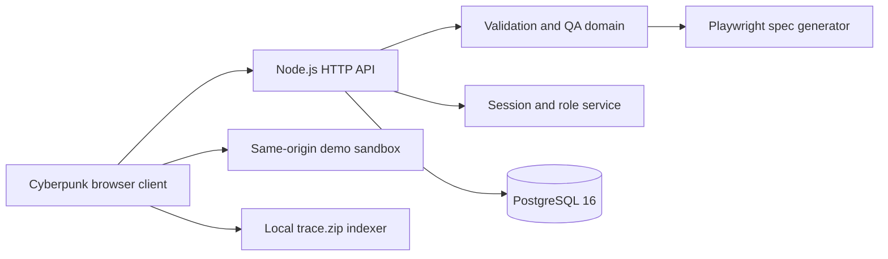

# TraceProof architecture

## System boundaries

TraceProof is a local-first portfolio application. A Node.js HTTP service serves the browser client, validates API input, applies role checks, generates Playwright specifications, and persists operational state. PostgreSQL 16 is the recommended durable store; an atomic JSON adapter exists for isolated tests and lightweight development.

## Components

- `server.js`: routing, headers, same-origin protection, authorization, platform actions, static assets.
- `lib/domain.js`: allowlisted routes/actions, normalized cases, runs, projects, metrics, and fictional seeds.
- `lib/auth.js`: scrypt verification, timing-safe comparisons, throttling, random sessions, hashed tokens.
- `lib/postgres-store.js`: schema bootstrap, parameterized queries, transactional synchronization, advisory locking.
- `public/`: responsive UI, particle Earth, workbench, trace inventory, platform control plane, account and legal flows.
- `sandbox/`: intentionally constrained shop and login fixtures used by browser replay.
- `db/schema.sql`: PostgreSQL tables and indexes.

## Data and trust

The Docker stack binds application and database ports to loopback. The application container runs as a non-root user with a read-only filesystem, dropped Linux capabilities, and no privilege escalation. Mutating APIs require JSON and reject foreign origins and cross-site Fetch Metadata. Browser code cannot navigate cases outside allowlisted sandbox routes.

Demo credentials and provider adapters are intentionally public and local. GitHub, Jira, Slack, SSO, cloud workers, encrypted object storage, and regional execution remain explicitly labelled simulation adapters until real credentials and infrastructure are supplied.

## Production evolution

A public multi-tenant deployment requires a managed identity provider, tenant-scoped authorization, distributed throttling, versioned migrations, encrypted backups/object storage, isolated Playwright workers, secret management, observability, retention jobs, and incident response.
